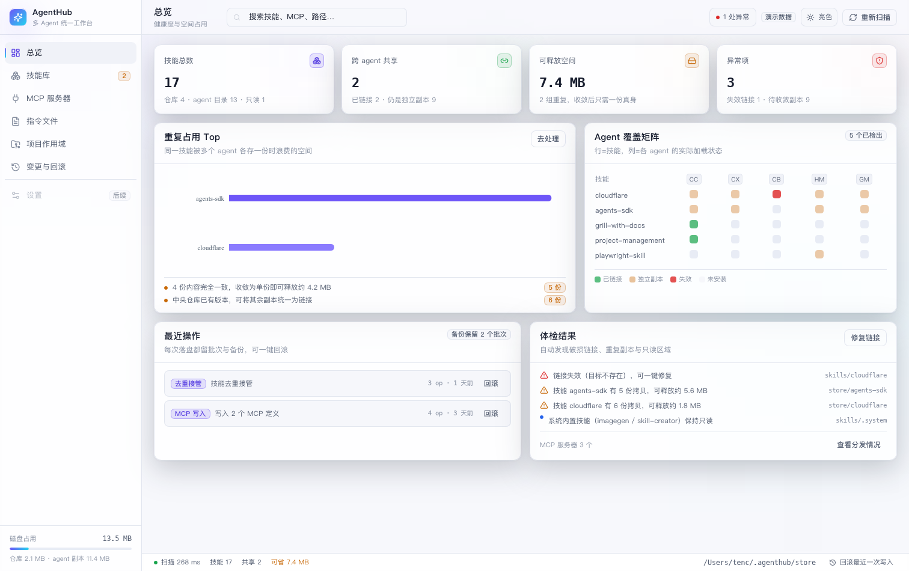
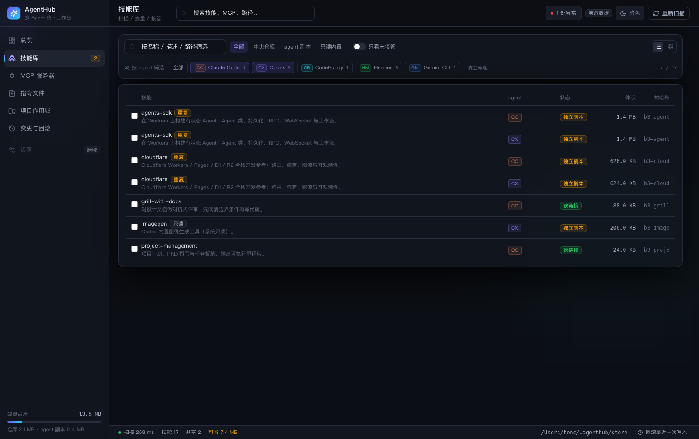
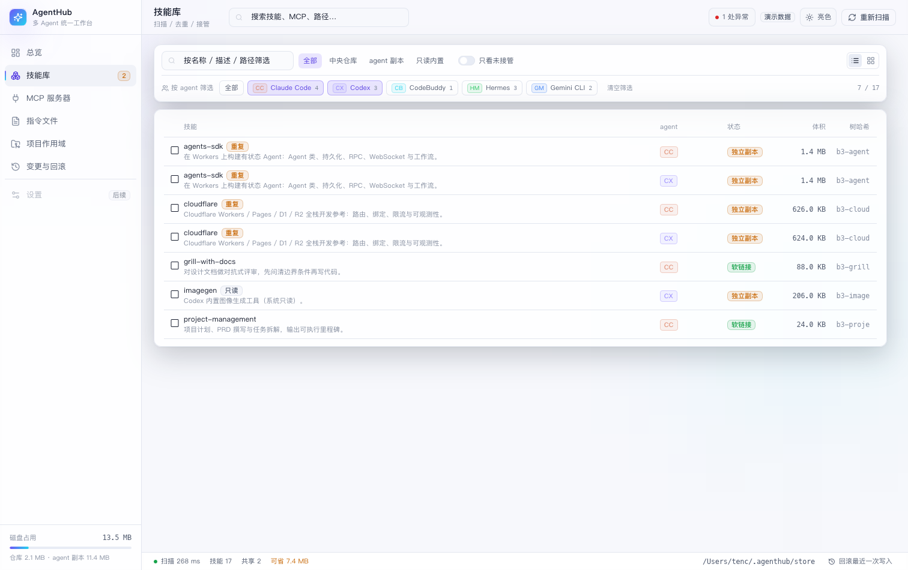
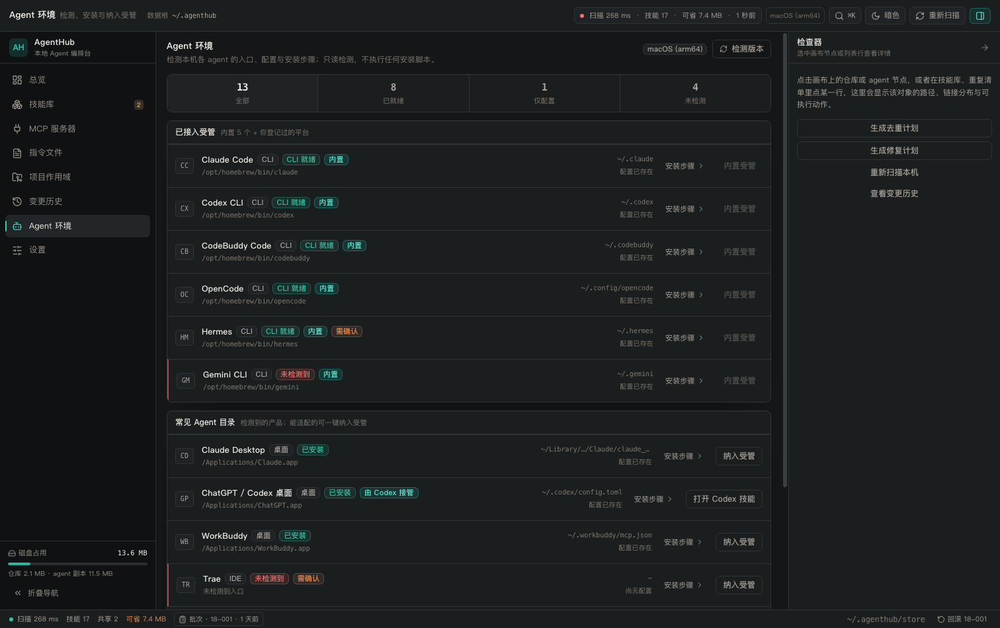
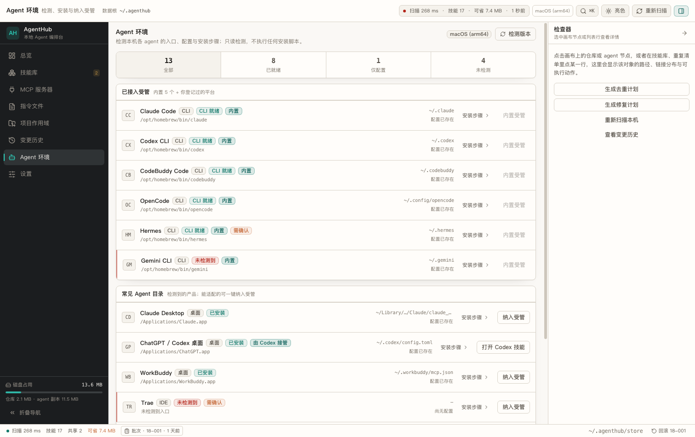
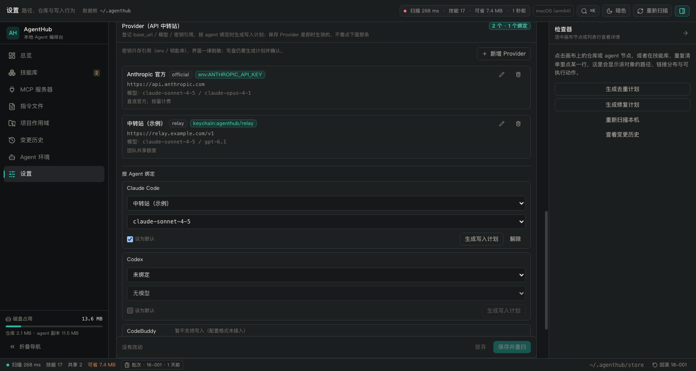
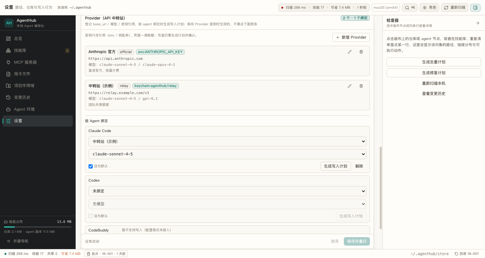
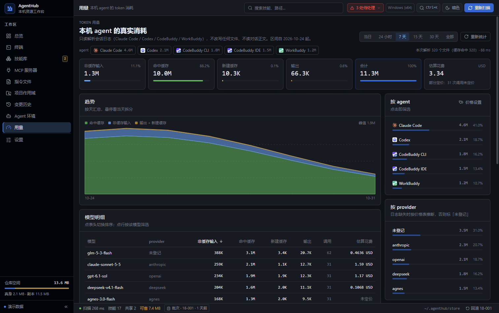
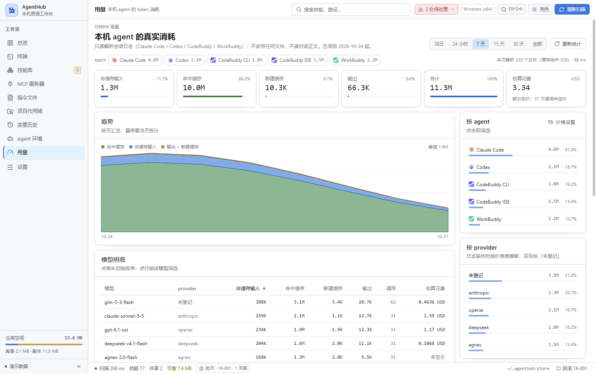

# AgentHub

> 一台电脑上装着 Claude Code、Codex、CodeBuddy、Hermes、Gemini、Trae、Manus 等多套 agent，同一个技能被各自装了一份，浪费磁盘、版本还容易飘。AgentHub 把它们收敛成**一份真身 + 多条链接**，并提供统一界面做扫描、去重、MCP 分发、指令文件托管与回滚。

Rust + Tauri 2，macOS / Windows 双端；核心逻辑在 `agenthub-core`，GUI 与 CLI 都是它的薄壳。



| 暗色 | 亮色 |
|---|---|
|  |  |
|  |  |
|  |  |
|  |  |

> 截图是**演示模式**（内置一套与真实环境同构的样本数据），所有交互都能走通，但不会碰你的目录。

## 它能解决什么

多数 agent 的技能目录是各自独立的：同一个技能在 Claude Code、Codex、CodeBuddy 下各存一份，手工同步必然漂移。
AgentHub 的做法是**链接优先**——内容只留一份，其余位置建链接指向它（macOS/Linux 软链，Windows 目录联接，可退回硬链接/复制）。

所有写操作都是两阶段的：先出计划，再执行；执行前把原件复制进批次备份，随时一键回滚。

## 能力一览

| 能力 | 说明 |
|---|---|
| 技能统一管理 | 扫描各 agent 的 skills 目录，识别同名多份；收敛到中央仓库后按平台建链接。agent 独有技能（`computer-use` 这类各家实现互不通用的）默认进白名单，不参与接管 |
| 技能市场 | 默认从 SkillHub 搜索技能、看正文与安全审核结论，设置页可切到 ClawHub。恶意标记直接拒装、可疑项给警告；下载物先落受管缓存，解包时拒绝越界路径与符号链接，**包内脚本从不执行** |
| 技能删除 | 列表与网格多选，确认后进计划抽屉逐条审阅；删真身时默认连带清理链接，整批可回滚 |
| MCP 统一管理 | 一份定义按目标格式生成：Claude/CodeBuddy/Gemini 的 JSON、Codex 的 TOML、Hermes 的 YAML；写入前先出 diff |
| 指令文件托管 | AGENTS.md / CLAUDE.md / SOUL.md 等以**受控区块**注入，用户原有内容逐字节保留；支持 `@AGENTS.md` 桥接 |
| 项目作用域 | 仓库内 `.agenthub/project.json` 记录启用项，只在项目内建链接 |
| 变更安全 | Plan/Apply 两阶段；原子写 + 批次备份 + 一键回滚；只读区永不被改写 |
| 内嵌终端 | 真实 PTY（Windows ConPTY / mac·Linux forkpty），一个标签一条会话，可直接拉起检测到的 agent CLI；支持搜索、导出、CJK 排宽、WebGL 渲染回退 |
| 供应商与网关 | 内置 21 个渠道，供应商全局维护、各 agent 自行订阅；本地网关只监听 `127.0.0.1:43117`，统一入口按 `Authorization` 令牌分派，支持 Anthropic Messages ⇄ Chat Completions 双向转换 |
| Token 用量 | 只读解析会话日志统计真实消耗，六档时间范围，按 agent / provider / 模型聚合；日志正文一律不读 |
| Agent 环境 | 检测 16 个常见 agent 的 CLI、应用包与配置目录，给出可复制的安装步骤；**只检测、只展示、只复制，不执行安装** |
| 界面 | 英文 / 简体中文 / 繁体中文三语，首次运行按系统语言自动选择；亮暗双主题；命令面板与全模块右键菜单 |

## 下载安装

到 [Releases](https://github.com/t3nc/AgentHub/releases) 下载对应平台的安装包：

| 平台 | 产物 |
|---|---|
| Windows | `AgentHub_<版本>_x64-setup.exe`（NSIS） |
| macOS | `AgentHub_<版本>_x64.dmg` / `aarch64.dmg` |

> **macOS 首次打开**：安装包未做 Apple 开发者签名与公证，系统会提示「无法验证开发者」。
> 请右键点击应用 → **打开**，或到「系统设置 → 隐私与安全性」里允许。也可以参照下面的构建章节自己编译。

## 从源码构建

依赖、构建命令、打包方式与排障，都在 **[docs/build.md](docs/build.md)**。

最短路径：

```bash
# CLI
cargo run -p agenthub-cli -- scan

# 桌面端（浏览器演示模式，改前端即时热更）
cd apps/desktop && npm ci && npm run dev      # http://localhost:5273

# 桌面端（原生窗口 + 一份可双击运行的二进制）
cd apps/desktop && npm run tauri build -- --no-bundle
```

## 快速上手

```bash
# 1. 只读扫描，不改任何东西
cargo run -p agenthub-cli -- scan

# 2. 看看哪里有重复
cargo run -p agenthub-cli -- duplicates

# 3. 生成去重计划（只打印，不落盘）
cargo run -p agenthub-cli -- plan-dedupe --out plan.json

# 4. 确认后执行（原件先进备份目录，可回滚）
cargo run -p agenthub-cli -- apply plan.json --yes

# 5. 出问题就回滚
cargo run -p agenthub-cli -- rollback <batch_id>
```

> **首次运行只做扫描**：AgentHub 不会自动改写任何目录，接管动作必须由你明确触发生成计划 + 确认执行。

## 数据落在哪

```
~/.agenthub/
├── config.json          # 仓库路径、默认链接策略、备份保留数、自定义平台、locale
├── index.db             # SQLite：树哈希缓存、已建链接、批次日志、用量缓存
├── store/               # 中央仓库：技能唯一真身
├── market/cache/        # 市场下载缓存
├── backups/<时间戳>/    # 每个批次的 manifest.json + 原件副本
└── logs/
```

- 想复用已有的 `~/.agents/skills`？把 `config.json` 的 `store_root` 指向它即可。
- 沙箱/测试：设 `AGENTHUB_HOME`（agent 目录根）与 `AGENTHUB_DATA_DIR`（数据目录）即可完全隔离。

## 安全边界

1. 所有写入前先出变更集，GUI / CLI 行为一致；apply 时逐条原子替换。
2. 替换或删除的原件先复制进批次备份，`manifest.json` 是回滚的唯一事实来源；任一操作失败会立即回滚本批次已完成的步骤。
3. 目标路径必须落在受管根目录内（agent 配置目录、仓库、已登记项目根），越界直接拒绝。
4. Codex 的 `skills/.system`、各 agent 的 marketplace / 隐藏目录一律只读。
5. MCP 密钥在库里只存 `env:VAR` / `keychain:service/account` 引用，落盘时才解析。
6. 内嵌终端故意不受写入门禁约束——它就是用户自己的 shell，关掉标签即结束进程。
7. 技能市场只在用户点搜索 / 详情 / 安装时联网；启动、扫描、刷新一律不联网。
8. Provider 网关只允许监听回环地址，请求日志只记元数据，不记正文与 header。
9. Token 用量只读：只取数字、模型名与时间戳，不读取会话正文。

漏洞报告方式见 [SECURITY.md](SECURITY.md)。

## 许可

本项目以**源码公开（source-available）**方式发布，**不是** OSI 认可的开源软件。完整条款见 [LICENSE](LICENSE)。

| 允许 | 不允许（需事先书面授权） |
|---|---|
| 个人使用、学习、修改、自行编译 | 销售、转售、出租、租赁本软件或衍生作品 |
| 在公司/组织**内部**当工具使用（不再对外分发） | 并入付费产品、付费服务或 SaaS 对外提供 |
| 分发副本与衍生作品（须保留许可与署名，并同样受本许可约束） | 以任何形式按下载/使用量收费 |
| 提供不交付本软件本身的咨询、支持、培训服务 | —— |

商业授权与条款疑问：**t3nc@outlook.com**

> **AgentHub 名称与图标不随代码许可授权。** 名称、Logo、图标的使用需要单独获得书面同意。

第三方组件保留各自许可：LobeHub 图标（MIT，见 `apps/desktop/src/assets/agents/LICENSE-lobehub-icons.txt`）、
内置兜底字体（OFL，见 `apps/desktop/src/assets/fonts/LICENSE-OFL.txt`）。

## 反馈与贡献

- Bug 与功能建议：[Issues](https://github.com/t3nc/AgentHub/issues)
- 提交改动前请先读 [CONTRIBUTING.md](CONTRIBUTING.md)。本仓库是对外发布快照，合并流程与常规仓库略有不同。
- 变更记录：[CHANGELOG.md](CHANGELOG.md)

## 致谢

功能逻辑参考 [konnga/skill-buddy](https://github.com/konnga/skill-buddy)（MIT），实现路线不同：
AgentHub 用 Rust + Tauri 2 + React 19，以链接优先取代「复制 + 漂移检测同步」。
